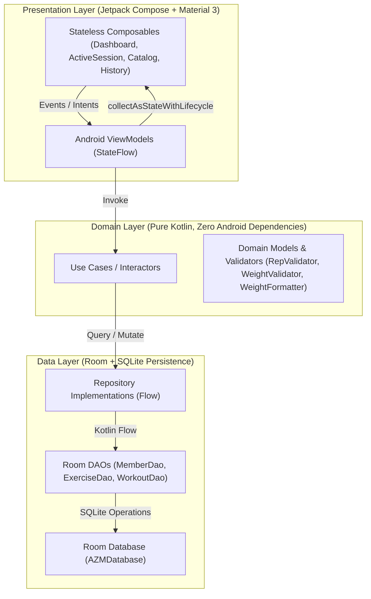
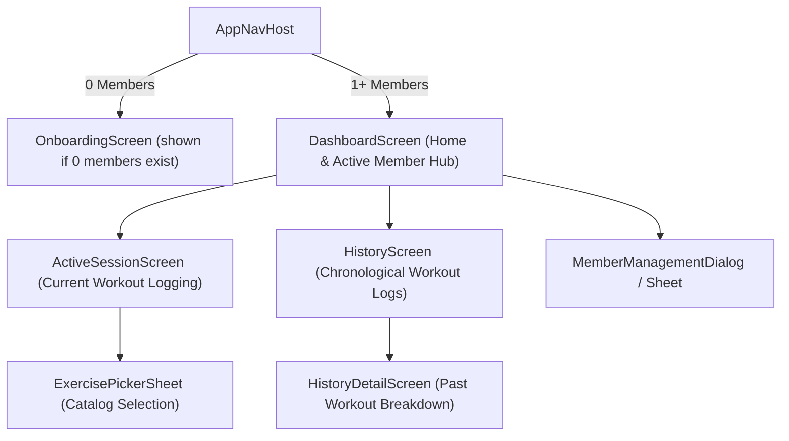

# Technical Implementation Plan: AZM / عزم MVP

**Feature**: `specs/001-mvp-workout-tracker`  
**Plan Artifact**: `specs/001-mvp-workout-tracker/plan.md`  
**Status**: Ready for Human Approval (Gate D)  
**Governing Documents**: [`.specify/memory/constitution.md`](file:///e:/AI%20Projects/AZM_GYMTracker/.specify/memory/constitution.md), [`specs/001-mvp-workout-tracker/spec.md`](file:///e:/AI%20Projects/AZM_GYMTracker/specs/001-mvp-workout-tracker/spec.md)  
**Date**: 2026-10-24  

---

## 1. Architecture & Module Boundaries

AZM strictly follows Android Architecture Guidelines using Unidirectional Data Flow (UDF) with a single-module (`:app`) layered package structure. This maximizes compilation speed while keeping UI, business logic, and database access strictly decoupled.



### Layer Responsibilities & Package Boundaries
- **`com.example.azm_gymtracker.ui.*`** (Presentation):
  - Composables driven by immutable `UiState`.
  - Android `ViewModel` state holders collecting and dispatching coroutine actions.
  - No direct SQL queries or Room imports in UI composables.
- **`com.example.azm_gymtracker.domain.*`** (Domain):
  - Pure Kotlin entities: `Member`, `Exercise`, `WorkoutSession`, `WorkoutExercise`, `WorkoutSet`.
  - Pure validation logic: `RepValidator`, `WeightValidator`, `MemberNameValidator`, `WeightFormatter`.
  - Use cases / interactors coordinating multi-repository transactions.
- **`com.example.azm_gymtracker.data.*`** (Data / Persistence):
  - Room entities: `MemberEntity`, `ExerciseEntity`, `WorkoutSessionEntity`, `WorkoutExerciseEntity`, `WorkoutSetEntity`.
  - DAOs exposing reactive Kotlin Coroutines `Flow` for reads and suspend functions for writes.
  - Room Database with pre-population callback for bilingual standard exercise catalog.
  - Repositories implementing clean domain interfaces.

---

## 2. Screen & Navigation Design

AZM uses **Navigation Compose** with type-safe route definitions hosted in [`MainActivity.kt`](file:///e:/AI%20Projects/AZM_GYMTracker/app/src/main/java/com/example/azm_gymtracker/MainActivity.kt).



### Screen Flow & State Recovery
1. **Initial Launch Check**:
   - `AppNavHost` checks member count: if 0, routes to `OnboardingScreen`; otherwise routes to `DashboardScreen`.
2. **`DashboardScreen`**:
   - Top App Bar with active member avatar and instant switcher dropdown.
   - **Resume Hero Card**: If the active member has an `IN_PROGRESS` session, displays an animated hero card showing elapsed timer, exercise count, and a primary "Resume Workout" button.
   - Primary "Start Workout" action if no session is active.
   - Recent workout summary card and quick navigation to History and Catalog.
3. **`ActiveSessionScreen`**:
   - Sticky header with elapsed time and Finish / Discard actions with confirmation dialogs.
   - Scrollable list of exercise cards with sequential set rows.
   - Set row layout: Set #, Previous set values (faded text), Reps input, Weight input (optional), Complete checkmark button.
   - "Add Exercise" button launching `ExercisePickerSheet`.
4. **`HistoryScreen` & `HistoryDetailScreen`**:
   - Filtered strictly by `active_member_id`.
   - Card summaries: Date/time, duration, total volume (kg), and exercise badges.
   - Detail view with inline set editing and delete workout controls.

---

## 3. Data Model & Database Relationships (Schema v2)

### Relational Schema (Room SQLite)

```
Member (1) ──< (N) SessionParticipant (N) >── (1) WorkoutSession (1) ──< (N) WorkoutExercise (1) ──< (N) WorkoutSet
                                                                                                       │
Member (1) ─────────────────────────────────────────────────────────────────────────────< (N) ───────┘ (member_id)
Exercise (1) ──< (N) WorkoutExercise
```

#### Table Definitions:

1. **`members`**:
   - `id`: `INTEGER PRIMARY KEY AUTOINCREMENT`
   - `name`: `TEXT NOT NULL` (Unique index `index_members_name` with `@ColumnInfo(collate = ColumnInfo.NOCASE)`)
   - `color_hex`: `TEXT NOT NULL`
   - `created_at`: `INTEGER NOT NULL`
2. **`exercises`**:
   - `id`: `INTEGER PRIMARY KEY AUTOINCREMENT`
   - `name_en`: `TEXT NOT NULL`
   - `name_ar`: `TEXT NOT NULL`
   - `category`: `TEXT NOT NULL` (Indexed)
   - `is_custom`: `INTEGER NOT NULL` (0 = standard, 1 = user custom)
   - `creator_member_id`: `INTEGER` (Foreign Key -> `members(id)` `ON DELETE SET NULL`)
3. **`workout_sessions`**:
   - `id`: `INTEGER PRIMARY KEY AUTOINCREMENT`
   - `status`: `TEXT NOT NULL` (`IN_PROGRESS`, `COMPLETED`, `CANCELLED`)
   - `started_at`: `INTEGER NOT NULL`
   - `ended_at`: `INTEGER`
   - `paused_total_ms`: `INTEGER NOT NULL DEFAULT 0`
   - `notes`: `TEXT`
   - **Index**: `(status)` for instant `IN_PROGRESS` query lookups across device.
4. **`session_participants`**:
   - `session_id`: `INTEGER NOT NULL` (Foreign Key -> `workout_sessions(id)` `ON DELETE CASCADE`)
   - `member_id`: `INTEGER NOT NULL` (Foreign Key -> `members(id)` `ON DELETE CASCADE`)
   - `join_order`: `INTEGER NOT NULL DEFAULT 0`
   - **Primary Key**: Composite `(session_id, member_id)`
   - **Indices**: `session_id`, `member_id`
5. **`workout_exercises`**:
   - `id`: `INTEGER PRIMARY KEY AUTOINCREMENT`
   - `workout_id`: `INTEGER NOT NULL` (Foreign Key -> `workout_sessions(id)` `ON DELETE CASCADE`)
   - `exercise_id`: `INTEGER NOT NULL` (Foreign Key -> `exercises(id)` `ON DELETE RESTRICT`)
   - `order_index`: `INTEGER NOT NULL`
6. **`workout_sets`**:
   - `id`: `INTEGER PRIMARY KEY AUTOINCREMENT`
   - `workout_exercise_id`: `INTEGER NOT NULL` (Foreign Key -> `workout_exercises(id)` `ON DELETE CASCADE`)
   - `member_id`: `INTEGER NOT NULL` (Foreign Key -> `members(id)` `ON DELETE CASCADE`)
   - `set_number`: `INTEGER NOT NULL`
   - `repetitions`: `INTEGER NOT NULL` (Range: 1–999)
   - `weight_kg`: `REAL` (Range: 0.0–999.5; NULL or 0.0 = bodyweight)
   - `is_completed`: `INTEGER NOT NULL DEFAULT 0`
   - `completed_at`: `INTEGER`
   - **Indices**: `workout_exercise_id`, `(workout_exercise_id, member_id)`
7. **`app_settings`**:
   - `key`: `TEXT PRIMARY KEY NOT NULL`
   - `value`: `TEXT NOT NULL`

---

## 4. Migration Strategy (v1 -> v2) & Data Integrity

### Room Migration 1 -> 2 (Executed in SQLite Transaction):
1. Create table `session_participants` and populate it from v1 data:
   `INSERT INTO session_participants (session_id, member_id, join_order) SELECT id, member_id, 0 FROM workout_sessions;`
2. Rebuild table `workout_sets` with non-nullable `member_id` (derived via `workout_exercises` -> `workout_sessions.member_id`), `is_completed`, and `completed_at`.
3. Rebuild table `workout_sessions` removing `member_id`, adding `paused_total_ms` (default 0) and `notes`, and mapping any existing `DISCARDED` status to `CANCELLED`.
4. Create table `app_settings` (key TEXT PRIMARY KEY, value TEXT).
5. Ensure `PRAGMA foreign_key_check` executes and passes in automated migration tests.
6. `fallbackToDestructiveMigration()` is strictly forbidden.

### Core Query & Integrity Rules:
- **Active Session Query**: `SELECT * FROM workout_sessions WHERE status = 'IN_PROGRESS' LIMIT 1` (device-wide single active session).
- **Session Finalization/Cancellation**: Executed strictly via `UPDATE workout_sessions SET status = :status, ended_at = :endedAt WHERE id = :sessionId`.
- **Atomic Index Calculation**: `order_index` for exercises and `set_number` for sets are calculated inside `@Transaction` blocks as `COALESCE(MAX(order_index), 0) + 1` and `COALESCE(MAX(set_number), 0) + 1`.
- **Orphan Session Cleanup**: After a member is deleted:
  `DELETE FROM workout_sessions WHERE id NOT IN (SELECT session_id FROM session_participants);`
- **Elapsed Timer Recovery**: Calculated dynamically from `(currentTime - startedAt - pausedTotalMs)` to survive process death and reboot without drifting.

---

## 5. Repository Contracts & Business Rules

### Repository Interfaces (`domain/repository/`)

```kotlin
interface MemberRepository {
    fun getAllMembers(): Flow<List<Member>>
    fun getActiveMember(): Flow<Member?>
    suspend fun setActiveMember(memberId: Long)
    suspend fun createMember(name: String, colorHex: String): Long
    suspend fun updateMember(member: Member)
    suspend fun deleteMember(memberId: Long)
}

interface ExerciseRepository {
    fun getAllExercises(): Flow<List<Exercise>>
    fun getExercisesByCategory(category: MuscleCategory): Flow<List<Exercise>>
    suspend fun createCustomExercise(nameEn: String, nameAr: String, category: MuscleCategory, memberId: Long): Long
    suspend fun searchExercises(query: String): List<Exercise>
}

interface WorkoutRepository {
    fun getActiveSession(): Flow<WorkoutSessionWithDetails?>
    fun getCompletedSessionsForMember(memberId: Long): Flow<List<WorkoutSessionSummary>>
    fun getSessionDetail(sessionId: Long): Flow<WorkoutSessionWithDetails?>
    fun getProgressStats(memberId: Long, timeRange: TimeRange): Flow<MemberProgressStats>
    suspend fun startSession(participantIds: List<Long>): Long
    suspend fun addParticipantToSession(sessionId: Long, memberId: Long)
    suspend fun addExerciseToSession(sessionId: Long, exerciseId: Long): Long
    suspend fun addSet(workoutExerciseId: Long, memberId: Long, reps: Int, weightKg: Double?): Long
    suspend fun updateSet(setId: Long, reps: Int, weightKg: Double?, isCompleted: Boolean)
    suspend fun deleteSet(setId: Long, workoutExerciseId: Long)
    suspend fun removeExerciseFromSession(workoutExerciseId: Long)
    suspend fun finishSession(sessionId: Long)
    suspend fun cancelSession(sessionId: Long)
    suspend fun deleteSession(sessionId: Long)
}
```

---

## 7. Dependency Compatibility & Justified Additions

### Additions to `gradle/libs.versions.toml`:
```toml
[versions]
# Existing versions preserved
agp = "9.2.1"
kotlin = "2.2.10"
coreKtx = "1.19.1"
lifecycleRuntimeKtx = "2.11.0"
activityCompose = "1.13.0"
composeBom = "2026.02.01"

# Justified Additions
room = "2.6.1"
ksp = "2.2.10-2.0.2"
navigationCompose = "2.8.8"
lifecycleViewmodelCompose = "2.8.7"
kotlinxCoroutines = "1.10.1"

[libraries]
androidx-room-runtime = { group = "androidx.room", name = "room-runtime", version.ref = "room" }
androidx-room-ktx = { group = "androidx.room", name = "room-ktx", version.ref = "room" }
androidx-room-compiler = { group = "androidx.room", name = "room-compiler", version.ref = "room" }
androidx-room-testing = { group = "androidx.room", name = "room-testing", version.ref = "room" }
androidx-navigation-compose = { group = "androidx.navigation", name = "navigation-compose", version.ref = "navigationCompose" }
androidx-lifecycle-viewmodel-compose = { group = "androidx.lifecycle", name = "lifecycle-viewmodel-compose", version.ref = "lifecycleViewmodelCompose" }
kotlinx-coroutines-test = { group = "org.jetbrains.kotlinx", name = "kotlinx-coroutines-test", version.ref = "kotlinxCoroutines" }

[plugins]
# Existing plugins preserved
android-application = { id = "com.android.application", version.ref = "agp" }
kotlin-compose = { id = "org.jetbrains.kotlin.plugin.compose", version.ref = "kotlin" }

# Justified Addition
ksp = { id = "com.google.devtools.ksp", version.ref = "ksp" }
```

### Technical Justifications:
- **Room 2.6.1 + KSP 2.2.10-2.0.2**: Room is the standard, secure offline-first SQLite ORM for Android, providing compile-time SQL verification and seamless Flow integration. KSP is the modern Kotlin symbol processor required by Kotlin 2.2.
- **Navigation Compose 2.8.8**: Required for decoupled, declarative Compose routing.
- **Lifecycle ViewModel Compose**: Provides `viewModel()` composable factory and `collectAsStateWithLifecycle()` lifecycle safety.

---

## 8. Arabic RTL & Numeric Formatting Architecture

### Formatting Pattern
```kotlin
object WeightFormatter {
    fun formatSetDisplay(reps: Int, weightKg: Double?, isArabic: Boolean): String {
        return if (weightKg == null || weightKg == 0.0) {
            if (isArabic) "$reps تكرار" else "$reps reps"
        } else {
            val weightStr = if (weightKg % 1.0 == 0.0) weightKg.toInt().toString() else weightKg.toString()
            if (isArabic) "$reps تكرار × $weightStr كغ" else "$reps reps × $weightStr kg"
        }
    }
}
```

### RTL Layout Direction Scoping
In composables displaying decimal weights, we apply explicit LTR direction wrapping:
```kotlin
CompositionLocalProvider(LocalLayoutDirection provides LayoutDirection.Ltr) {
    Text(
        text = WeightFormatter.formatSetDisplay(set.reps, set.weightKg, isArabic),
        style = MaterialTheme.typography.bodyLarge
    )
}
```
All interactive buttons and set rows are tested to meet the 48x48 dp touch target requirement.

---

## 9. Testing & Build Verification Strategy

### Automated Test Matrix
1. **Domain Unit Tests** (`app/src/test/`):
   - `MemberNameValidatorTest`: Empty, whitespace, max length, valid names.
   - `RepValidatorTest`: 0, negative, >999, valid numbers.
   - `WeightValidatorTest`: Blank, 0, decimals, max values.
   - `WeightFormatterTest`: English & Arabic string generation, decimal point placement.
2. **Room Persistence Tests** (`app/src/test/` or `app/src/androidTest/`):
   - In-memory `Room.inMemoryDatabaseBuilder`:
     - `MemberDaoTest`: Insertion, unique name constraint, deletion.
     - `WorkoutSessionDaoTest`: Multi-member concurrent `IN_PROGRESS` isolation.
     - `CascadeDeleteTest`: Verifies deleting member removes sessions, exercises, and sets.
     - `SetReindexTest`: Verifies deleting a set decrements subsequent set numbers.
3. **ViewModel Tests** (`app/src/test/` with `StandardTestDispatcher`):
   - `ActiveSessionViewModelTest`: Start workout, add exercise, add set, finish workout.
   - `MemberViewModelTest`: Switching member updates active member state.
4. **Build Verification**:
   - Command: `./gradlew test` (verifies all unit and DAO tests).
   - Command: `./gradlew assembleDebug` (verifies clean compilation and APK generation).

---

## 10. Implementation Sequence, Risks & Rollback

### Incremental Milestones:
- **Milestone 1**: Dependencies & Gradle Build Config (`libs.versions.toml`, `build.gradle.kts`, verification via `gradlew help`).
- **Milestone 2**: Domain Models, Validators & Room Persistence Layer (Entities, DAOs, Database, in-memory DAO tests).
- **Milestone 3**: Repositories & ViewModels with Coroutines Flow and Unit Tests.
- **Milestone 4**: Compose UI & Navigation (Dashboard, Active Session, History, Catalog, Member Switcher).
- **Milestone 5**: Arabic RTL & Localization Resource Bundle (`strings.xml`, `strings-ar.xml`).
- **Milestone 6**: End-to-end verification, full test suite execution, and debug APK build.

### Risk & Mitigation Table:
| Risk | Probability | Impact | Mitigation Strategy |
| :--- | :---: | :---: | :--- |
| **KSP / Kotlin Version Mismatch** | Low | High | Pinned exact compatible release `2.2.10-2.0.2` verified against Maven Central. |
| **Decimal Inversion in Arabic** | Medium | Medium | Unit-tested `WeightFormatter` + Compose `LocalLayoutDirection.Ltr` wrapper. |
| **Process Death Data Loss** | Low | High | Active sets and session updates persisted immediately to SQLite on completion. |

---

## 11. Major Technical Decisions & Evaluated Alternatives

1. **Persistence Engine**:
   - *Chosen*: Room with SQLite.
   - *Alternative Evaluated*: DataStore / Flat JSON files.
   - *Rationale*: DataStore is inadequate for multi-member relational structures with foreign keys, sequential set re-indexing, and historical queries. Room provides compile-time query verification and ACID transactions.
2. **Dependency Injection**:
   - *Chosen*: Lightweight manual AppContainer / ViewModelFactory.
   - *Alternative Evaluated*: Hilt / Dagger.
   - *Rationale*: Avoids heavy annotation-processing overhead and kapt/ksp plugin bloat for an offline-first MVP, while keeping architecture 100% clean and testable.
3. **Multi-Member Active Sessions**:
   - *Chosen*: Concurrent `IN_PROGRESS` sessions (one per member).
   - *Alternative Evaluated*: Strict single active session per device.
   - *Rationale*: Allows training partners sharing a device to alternate using the app during a shared workout without discarding or forcibly finishing each other's sessions.

---

## 12. Human Approval Request (Gate D)

Please review this Technical Implementation Plan.  
Do you approve the plan to proceed to **Gate E: Requirements Quality Checklist & Task Breakdown (`checklist.md` / `tasks.md`)** via `/speckit.checklist` and `/speckit.tasks`?
